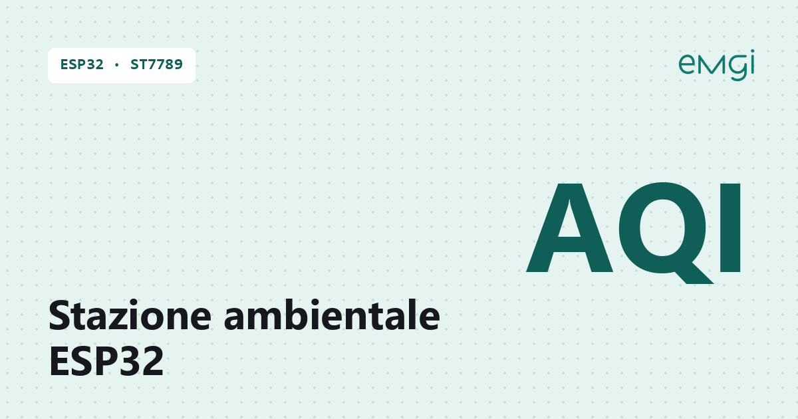

# Stazione ambientale ESP32 con display ST7789, ENS160, AHT21, BMP280 e luminosità ambiente APDS-9930

> 📖 **Articolo completo con schema, foto e spiegazioni passo passo:**  
> **[Stazione ambientale ESP32 con display ST7789, ENS160, AHT21, BMP280 e luminosità ambiente APDS-9930 – www.emgi.it](https://www.emgi.it/2026/04/05/stazione-ambientale-esp32-con-st7789-ens160-aht21-e-bmp280/)**
>
> Altri progetti di elettronica, Arduino, ESP32, Home Assistant e stampa 3D su **[www.emgi.it](https://www.emgi.it)**

Questo progetto si integra in Home Assistant. Se non l’hai ancora installato, parti dalla guida [Come installare Home Assistant su Raspberry Pi 4, 5 e Zero](https://www.emgi.it/2026/04/14/installare-home-assistant-su-raspberry-pi/).

Ho realizzato una stazione ambientale compatta basata su **ESP32 D1 Mini32** e display **ST7789V 240×320**, pensata per monitorare in tempo reale i principali parametri ambientali indoor con una grafica chiara, stabile e leggibile.

## Caratteristiche principali

Questa versione evoluta include:

- display **sempre attivo**
- rotazione automatica delle pagine
- tempo di cambio pagina configurabile da **pagina web**
- modalità **giorno/notte** con dimmer software
- utilizzo dei **lux** letti da APDS-9930 per la gestione automatica della luminosità grafica
- impostazioni salvate nella memoria non volatile dell’ESP32
- **storico dati** con buffer circolare
- **mini grafici** sul display
- **soglie personalizzate** per i principali parametri ambientali
- stato **allarmi** visibile da display e da browser
- **esportazione dati via rete** in JSON e CSV
- integrazione predisposta per **Home Assistant**

## Componenti utilizzati

- **ESP32 D1 Mini32**
- **display ST7789V 240×320 SPI**
- **modulo ENS160 + AHT21**
- **modulo BMP280 + AHT20**
- **modulo APDS-9930**
- cavetti Dupont
- alimentazione 5V USB

## Librerie utilizzate

Per compilare il progetto in Arduino IDE servono queste librerie:

- **Adafruit AHTX0**
- **Adafruit Unified Sensor**
- **Adafruit BMP280 Library**
- **Adafruit GFX Library**
- **Adafruit ST7735 and ST7789 Library**
- **DFRobot_ENS160**

## Contenuto del repository

| Percorso | Descrizione |
|---|---|
| `Stazione_Ambientale/` | Cartella dello sketch (tutti i file) |
| `case_3d/stazione_ambientale_body.stl` | Modello 3D da stampare |
| `case_3d/stazione_ambientale_bottom.stl` | Modello 3D da stampare |
| `case_3d/stazione_ambientale_foot.stl` | Modello 3D da stampare |
| `immagini/` | Foto e immagini dell'articolo |

## Come si usa

1. Apri [`Stazione_Ambientale/Stazione_Ambientale.ino`](Stazione_Ambientale) con Arduino IDE (la cartella contiene tutti i file dello sketch).
2. Leggi [`Stazione_Ambientale/README.txt`](Stazione_Ambientale/README.txt) per librerie e configurazione.
3. Stampa i tre pezzi del case dalla cartella [`case_3d`](case_3d).

Schema dei collegamenti, dettagli e risoluzione dei problemi: **[articolo su www.emgi.it](https://www.emgi.it/2026/04/05/stazione-ambientale-esp32-con-st7789-ens160-aht21-e-bmp280/)**.

## Licenza

- Codice e configurazioni: [MIT](LICENSE)
- Modelli 3D, schemi e immagini: [CC BY-SA 4.0](https://creativecommons.org/licenses/by-sa/4.0/deed.it)

---

**Autore:** Massimiliano Sandrin – **[eMGi.it](https://www.emgi.it)** · Domande e commenti sotto l'[articolo sul sito](https://www.emgi.it/2026/04/05/stazione-ambientale-esp32-con-st7789-ens160-aht21-e-bmp280/).
